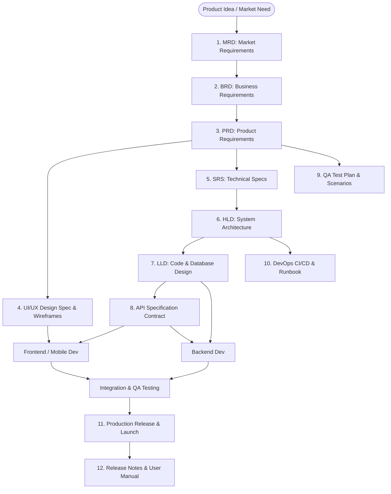
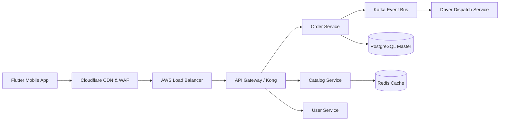

# 📱 Master Guide: Software & App Development Documentation

> **Complete End-to-End Reference:** App development me idea se lekar launch aur maintenance tak kaun-kaun se documents ki zaroorat hoti hai — unka complete explanation, industry best practices, templates, aur real-world examples ek hi jagah par.  
> **Target Audience:** Developers, Product Managers, System Architects, Founders, Business Analysts, and Students.

---

## 📑 Table of Contents

1. [Kyun Zaroori Hote Hain Documents? (Why Documentation Matters)](#1-kyun-zaroori-hote-hain-documents)
2. [Document Dependency Lifecycle (SDLC Overview)](#2-document-dependency-lifecycle)
3. [Master Matrix: Har Document Ka Role Aur Owner](#3-master-matrix-har-document-ka-role-aur-owner)
4. [Document 1: MRD (Market Requirements Document)](#document-1-mrd-market-requirements-document)
5. [Document 2: BRD (Business Requirements Document)](#document-2-brd-business-requirements-document)
6. [Document 3: PRD (Product Requirements Document)](#document-3-prd-product-requirements-document)
7. [Document 4: SRS (Software Requirements Specification)](#document-4-srs-software-requirements-specification)
8. [Document 5: UI/UX Design Specification & Style Guide](#document-5-uiux-design-specification)
9. [Document 6: HLD (High-Level Design / System Architecture)](#document-6-hld-high-level-design--system-architecture)
10. [Document 7: LLD (Low-Level Design & Database Schema)](#document-7-lld-low-level-design--database-schema)
11. [Document 8: API Specification (Swagger / OpenAPI Contract)](#document-8-api-specification)
12. [Document 9: QA Test Plan & Test Cases Suite](#document-9-qa-test-plan--test-cases-suite)
13. [Document 10: DevOps CI/CD Pipeline & Deployment Runbook](#document-10-devops-cicd-pipeline--deployment-runbook)
14. [Document 11: Release Notes & Changelog](#document-11-release-notes--changelog)
15. [Document 12: User Manual & Help Center SOP](#document-12-user-manual--help-center-sop)
16. [GitHub Setup & Push Guide (Terminal Commands)](#16-github-setup--push-guide)

---

## 1. Kyun Zaroori Hote Hain Documents?

Jab bhi koi startup ya enterprise company software/app banati hai, sabse badi galti hoti hai **"Direct Coding Shuru Kar Dena"**. 

Bina documentation ke kaam karne par yeh problems aati hain:
- **Scope Creep:** Client ya business team har hafte naye features maangti hai, deadline miss ho jati hai.
- **Miscommunication:** Designer kuch aur design karta hai, Backend developer kuch aur API banata hai, aur Mobile app developer confuse rehta hai.
- **High Bug Rate & Crashes:** Architecture pehle se plan na hone par scale karte hi servers crash hone lagte hain.
- **Developer Onboarding Pain:** Jab naya developer team join karta hai, use samajhne me mahine lag jate hain ki code kaise kaam kar raha hai.

**Achha documentation = Faster development + Zero confusion + High code quality.**

---

## 2. Document Dependency Lifecycle

Yeh visual chart batata hai ki kaun sa document kiske baad banta hai aur aapas me kaise link hota hai:



---

## 3. Master Matrix: Har Document Ka Role Aur Owner

| Phase | Document | Owner (Kaun Likhta Hai?) | Key Deliverable | Real-World Example |
|---|---|---|---|---|
| **Strategy** | **MRD** | Product Marketing / Founder | Market problem, competitor analysis, personas | "Office workers need hot lunch in 15 mins" |
| **Business** | **BRD** | Business Analyst / PM | Business goals, ROI, budget, high-level scope | "Generate ₹50 Lakh monthly via 15% commission" |
| **Product** | **PRD** | Product Manager | User stories, acceptance criteria, edge cases | "As a user, track live delivery boy on map" |
| **Technical**| **SRS** | System Analyst / Tech Lead | IEEE functional & non-functional system specs | "System must support 5,000 req/sec at <150ms" |
| **Design** | **UI/UX Spec** | Lead UI/UX Designer | Design tokens, typography, screens, Figma links | "Primary button #FF4B2B with 12px border radius" |
| **Architecture**| **HLD** | Principal Solution Architect | System architecture, microservices, cloud infra | "AWS EKS cluster + Kafka event bus + PostgreSQL" |
| **Engineering**| **LLD** | Tech Lead / Senior Dev | Class diagrams, database ERD, algorithms | "Order table schema + Driver allocation algorithm" |
| **Contracts** | **API Spec** | Backend Engineer | OpenAPI / Swagger endpoints & JSON payloads | `POST /v1/orders` request & response schema |
| **Quality** | **QA Plan** | QA Lead / Test Engineer | Test cases, device matrix, bug severity | "Test login with invalid OTP 5 times" |
| **Operations** | **DevOps** | DevOps / SRE Engineer | CI/CD pipelines, Docker, Kubernetes, Runbooks | "GitHub Actions script + Emergency rollback SOP" |
| **Delivery** | **Release Notes**| PM / Tech Writer | Version notes, bug fixes, store changelogs | "v1.2.0: Added live order tracking & UPI payments" |

---

## Document 1: MRD (Market Requirements Document)

### Kya Hai?
Yeh document market research aur business opportunity par focus karta hai. Yeh batata hai ki **market me kya problem hai** aur hamari app usko kaise solve karegi.

### Main Sections:
1. **Executive Summary:** App ka vision aur market me aane ka purpose.
2. **Target Audience (Customer Persona):** User ki age, job, salary, routine, pain points.
3. **Market Sizing (TAM / SAM / SOM):** Market ka total size aur hum kitna capture kar sakte hain.
4. **Competitor Analysis:** Kaun-kaun se existing players hain aur unme kya kami hai.
5. **USP (Unique Selling Proposition):** Log hamari app hi kyun use karenge?
6. **Monetization Strategy:** App paise kaise kamayegi (Subscriptions, Ads, Commission).

### Concrete Example:
> **App:** QuickBite  
> **Market Pain Point:** IT Park employees ko 1 ghante ka lunch break milta hai. Swiggy/Zomato 45-50 min lagati hain. Cafeteria me 20 min ki line hoti hai.  
> **QuickBite Solution:** 15-minute guaranteed express hot lunch delivery directly at corporate tech park reception or desk.  
> **Target Persona:** IT Software Engineers & Corporate Staff aged 22-38 years.

---

## Document 2: BRD (Business Requirements Document)

### Kya Hai?
Yeh business stakeholders, investors aur clients ke beech ka agreement hota hai. Isme technical details nahi hoti, balki **business outcomes, rules, budget aur timeline** hote hain.

### Main Sections:
1. **Business Objectives:** 6 mahine me 25,000 active orders cross karna.
2. **Scope of Work (In-Scope vs Out-of-Scope):** Phase 1 me kya banega aur kya baad ke liye postpone kiya gaya hai.
3. **Success KPIs:** Monthly Active Users (MAU), Customer Acquisition Cost (CAC), Average Order Value (AOV).
4. **Business Rules:** Cancellation sirf 60 seconds me allow hogi; agar order 15 min late hua to 50% cashback credit hoga.
5. **Project Budget & Timelines:** Total budget ₹45 Lakh, launch target 4 months.

---

## Document 3: PRD (Product Requirements Document)

### Kya Hai?
Yeh software development ka **sabse vital document** hota hai. Product Manager ise likhta hai taaki designers aur developers ko exactly pata ho ki har screen par kya hoga aur user kya action perform kar sakega.

### Main Sections:
1. **User Personas:** Kis user ke liye feature ban raha hai.
2. **Feature List with Prioritization (MoSCoW):**
   - *Must Have (P0):* MVP launch ke liye mandatory.
   - *Should Have (P1):* Important, but can wait for v1.1.
   - *Could Have (P2):* Nice-to-have features for future.
   - *Won't Have:* Initial launch me intentionally chhod diye gaye features.
3. **User Stories & Acceptance Criteria:**
   - Format: *As a [User], I want to [Action], So that [Value].*
4. **Edge Cases & Error Handling:** Network drop hone par, payment fail hone par, item out-of-stock hone par app kya karegi.
5. **Non-Functional Requirements (NFRs):** Speed (<1.5s load), Security (AES-256), Uptime (99.9%).

### Real-World Example User Story:
> **Story:** *As a hungry corporate customer, I want to see my delivery driver's live GPS location on a map with an estimated arrival time, so that I can step down to the reception right on time.*  
> **Acceptance Criteria:**  
> - Map par Cloud Kitchen, Driver aur Customer ke markers show hone chahiye.  
> - Driver icon har 4 second me animate hokar new position par update hona chahiye via WebSockets.  
> - Real-time ETA traffic ke hisaab se calculate hona chahiye.  
> - Ek tap me call button khulna chahiye with phone number masking (privacy protection).

---

## Document 4: SRS (Software Requirements Specification)

### Kya Hai?
IEEE 830 standard par based technical requirement document jo PRD ko technical team ke liye translate karta hai.

### Main Sections:
1. **External Interfaces:** Hardware interfaces (GPS, Camera, Biometric sensor), Software interfaces (Payment gateways, Push notification servers).
2. **System Constraints:** Memory limits (app size under 40MB), Battery consumption limits (< 3% per 30 mins live tracking).
3. **Security Standards:** OWASP compliance, TLS 1.3, Token storage in iOS Keychain & Android Keystore.

---

## Document 5: UI/UX Design Specification & Style Guide

### Kya Hai?
Designers aur frontend developers ke beech ka visual standard. Isme wireframes, Figma screens aur design tokens hote hain.

### Main Sections:
1. **Information Architecture (IA):** Navigation tree and screen transitions.
2. **Color Palette & Design Tokens:**
   - Primary Brand Color: `#FF4B2B`
   - Dark Surface: `#0D1B2A`
   - Success Green: `#10B981`
   - Warning/Error: `#EF4444`
3. **Typography:** Font family (Inter / Roboto), Headings scale (H1: 28px, H2: 20px, Body: 14px).
4. **Spacing System:** 8-point grid (`8px`, `16px`, `24px`, `32px`).
5. **Component States:** Buttons ke Default, Hover, Pressed, Disabled, aur Loading states.
6. **Micro-interactions:** Animations, skeleton shimmers, swipe gestures, haptic feedback.

---

## Document 6: HLD (High-Level Design / System Architecture)

### Kya Hai?
Software Architect ka master plan jo batata hai ki pura system high scale par kaise chalega.



### Main Sections:
1. **Architecture Style:** Monolith vs Microservices vs Serverless.
2. **Tech Stack Justification:**
   - Mobile: *Flutter* (Cross-platform iOS + Android, single codebase).
   - Backend: *Node.js / NestJS* with TypeScript (Fast asynchronous I/O).
   - Database: *PostgreSQL* for ACID transactions + *Redis* for fast in-memory caching and geospatial radius queries.
3. **Cloud Infrastructure:** AWS Mumbai (ap-south-1) with EKS (Elastic Kubernetes Service), S3, RDS Multi-AZ.
4. **Scalability & Caching:** CDN caching, Redis menu caching, Database read/write replicas.
5. **Disaster Recovery (DR):** RPO < 5 mins, RTO < 15 mins.

---

## Document 7: LLD (Low-Level Design & Database Schema)

### Kya Hai?
Senior Developers aur Engineering Leads ke liye detailed technical design. Isme database tables, class diagrams, design patterns aur algorithms defined hote hain.

### Main Sections:
1. **Database Schema (ERD):** Tables, Primary Keys, Foreign Keys, Indexes, Constraints.
2. **Design Patterns Used:**
   - *Strategy Pattern:* For dynamically switching between Razorpay, Stripe, and Cashfree.
   - *Observer Pattern / Event Emitter:* Order status change triggers notifications.
   - *Repository Pattern:* Data access layer decoupling.
3. **State Machine:** Order Lifecycle (CREATED ➔ PAYMENT_PENDING ➔ CONFIRMED ➔ PREPARING ➔ OUT_FOR_DELIVERY ➔ DELIVERED).
4. **Core Algorithms:** Driver allocation logic using Redis `GEOSEARCH` to find riders within 1.5km.

---

## Document 8: API Specification (OpenAPI / Swagger Contract)

### Kya Hai?
Frontend aur Backend developers ke beech ka legal agreement. Iske bina frontend developer ko backend ka wait karna padta hai.

### Standard Format Example:
- **Endpoint:** `POST /api/v1/orders`
- **Headers:** `Authorization: Bearer <JWT_TOKEN>`
- **Request Body (JSON):**
```json
{
  "restaurant_id": "rest_88194a",
  "items": [
    { "menu_item_id": "item_thali_01", "quantity": 1 }
  ],
  "delivery_address_id": "addr_office_desk_4"
}
```
- **Response (201 Created):**
```json
{
  "success": true,
  "data": {
    "order_id": "ord_99014",
    "status": "PAYMENT_PENDING",
    "total_amount": 250.00,
    "payment_gateway": {
      "provider": "RAZORPAY",
      "order_id": "order_rzp_99014"
    }
  }
}
```

---

## Document 9: QA Test Plan & Test Cases Suite

### Kya Hai?
Testing team ka master plan jo release se pehle app ki quality, performance aur security verify karta hai.

### Key Sections:
1. **Test Strategy:** Functional testing, Smoke testing, Regression testing, Load/Stress testing (JMeter / k6).
2. **Device & OS Matrix:** iPhone 15 (iOS 17), iPhone 11 (iOS 16), Samsung S23 (Android 14), Redmi Note (Budget Android).
3. **Test Case Format:**
   - *Test ID:* `TC-CHECKOUT-01`
   - *Scenario:* User attempts checkout with expired promotional coupon.
   - *Steps:* 1. Add item to cart ➔ 2. Enter expired coupon "EXPIRED50" ➔ 3. Tap Apply.
   - *Expected Result:* Red error displayed: *"This coupon has expired"*. Total bill amount unchanged.
   - *Status:* Pass / Fail.
   - *Severity:* Blocker / Critical / Major / Minor.

---

## Document 10: DevOps CI/CD Pipeline & Deployment Runbook

### Kya Hai?
Code ko developer ke laptop se lekar production cloud aur Google Play / Apple App Store tak automatically aur safely pahunchane ka process.

### Key Sections:
1. **Git Branching Strategy:** Feature branches ➔ `develop` ➔ `staging` ➔ `main` (Production).
2. **Automated CI Pipeline:** Har pull request par automatic code linting, unit test execution, aur security vulnerability scanning.
3. **Deployment Runbook (SOP):**
   - Off-peak deployment timing.
   - Database migration execution command.
   - Post-deployment smoke test verification.
4. **Emergency Rollback Plan:** Agar deploy ke 5 minute me errors spike ho jayein to `kubectl rollout undo` run karke pichle stable version par revert karne ka standard operating procedure.

---

## Document 11: Release Notes & Changelog

### Kya Hai?
App launch ya update ke sath release hone wala document jo end-users, management aur App Store reviewers ko batata hai ki naye version me kya badlaav hue hain.

### Standard Format:
- **Version:** v1.2.0 (Build 120)
- **New Features (✨):** Live map tracking, 1-click UPI payments.
- **Improvements (⚡):** App launch time reduced by 40%.
- **Bug Fixes (🐛):** Fixed keyboard layout shift on Android checkout screen.

---

## Document 12: User Manual & Help Center SOP

### Kya Hai?
Customer Support team aur end-users ke liye user-friendly documentation.
- How to create an account
- How to track an active order
- How to request a refund or report a missing dish
- Frequently Asked Questions (FAQs)

---

## 16. GitHub Setup & Push Guide

Aap is pure documentation project ko apne GitHub account par push karne ke liye neeche diye gaye steps follow karein:

```bash
# Step 1: Terminal / Command Prompt kholein aur project folder me jayein:
cd "a:\New folder (2)"

# Step 2: Git repository initialize karein:
git init

# Step 3: Saari files add karein:
git add .

# Step 4: Initial commit create karein:
git commit -m "feat: complete app development documentation guide, templates and case study"

# Step 5: Main branch set karein:
git branch -M main

# Step 6: GitHub par nayi empty repository banayein aur uska link remote add karein:
git remote add origin https://github.com/<YOUR_GITHUB_USERNAME>/<YOUR_REPO_NAME>.git

# Step 7: GitHub par push karein:
git push -u origin main
```

---

*Written with precision for software engineering excellence.*
