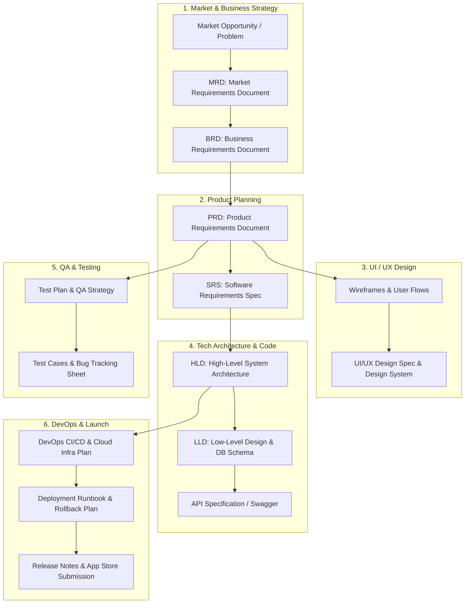

# 📱 End-to-End App Development Documentation Guide & Templates

[](https://opensource.org/licenses/MIT)
[](http://makeapullrequest.com)
[](#)

> **Ek complete, beginner-to-advanced guide aur production-ready templates jo batata hai ki kisi bhi Mobile App ya Web App ko banate waqt shuru se lekar launch aur maintenance tak kaun-kaun se documents ki zaroorat hoti hai.**

---

## 📑 Table of Contents (Index)

1. [App Development Lifecycle (SDLC) & Documentation Flow](#1-app-development-lifecycle-sdlc--documentation-flow)
2. [Master Document Summary Matrix](#2-master-document-summary-matrix)
3. [Deep-Dive: Kaunsa Document Kya Hota Hai (With Examples)](#3-deep-dive-kaunsa-document-kya-hota-hai)
   - [Phase 1: Idea & Strategy (MRD, BRD)](#phase-1-idea--strategy)
   - [Phase 2: Product & Feature Scoping (PRD, SRS)](#phase-2-product--feature-scoping)
   - [Phase 3: Design & UX (UI/UX Spec, Wireframes)](#phase-3-design--ux)
   - [Phase 4: Technical Architecture & Engineering (HLD, LLD, API Spec, DB Schema)](#phase-4-technical-architecture--engineering)
   - [Phase 5: Quality Assurance & Testing (Test Plan, Test Cases)](#phase-5-quality-assurance--testing)
   - [Phase 6: Deployment & DevOps (CI/CD Pipeline, Runbook/SOP)](#phase-6-deployment--devops)
   - [Phase 7: Launch & Maintenance (Release Notes, User Manual)](#phase-7-launch--maintenance)
4. [Folder Structure in this Repository](#4-folder-structure-in-this-repository)
5. [How to Push This Project to GitHub](#5-how-to-push-this-project-to-github)

---

## 1. App Development Lifecycle (SDLC) & Documentation Flow

Jab bhi koi real-world app (jaise Zomato, Uber, WhatsApp, Paytm) banti hai, to direct coding shuru nahi hoti. Pehle research, planning, design aur architecture ke documents bante hain taaki developers, designers, business team aur clients ke beech koi confusion na rahe.



---

## 2. Master Document Summary Matrix

Neeche di gayi table se aap ek nazar me samajh sakte hain ki kaun sa document kab banta hai, kaun banata hai aur uska main maqsad kya hota hai:

| # | Document Name | Full Form | Kaun Banata Hai? (Owner) | Kis Ke Liye Hota Hai? (Audience) | Main Purpose (Kyun Zaroori Hai) |
|---|---------------|-----------|--------------------------|----------------------------------|----------------------------------|
| 1 | **MRD** | Market Requirements Document | Product Marketing Manager / Founder | Stakeholders, Leadership, PM | Market research, competitor analysis, pricing & customer target samajhne ke liye |
| 2 | **BRD** | Business Requirements Document | Business Analyst (BA) / PM | Clients, Executives, PM, Tech Lead | Business problem, ROI, high-level business rules aur success metrics define karne ke liye |
| 3 | **PRD** | Product Requirements Document | Product Manager (PM) | Designers, Developers, QA, Leads | App ke features, user stories, acceptance criteria aur MVP scope define karne ke liye |
| 4 | **SRS** | Software Requirements Specification | Tech Lead / System Analyst | Developers, QA, Architects | Functional & non-functional requirements ka technical specification |
| 5 | **UI/UX Spec** | Design Specification & Guidelines | UI/UX Designer | Frontend Developers, PM | Wireframes, color palette, typography, micro-interactions aur design tokens |
| 6 | **HLD** | High-Level Design (System Architecture) | Solution / Software Architect | Engineering Team, DevOps | Server architecture, microservices, cloud infra, scaling, caching aur data flow |
| 7 | **LLD** | Low-Level Design | Senior Developer / Tech Lead | Backend/Mobile Developers | Class diagrams, database tables (ERD), algorithms, state management logic |
| 8 | **API Spec** | API Documentation (Swagger/OpenAPI) | Backend Engineer / Tech Lead | Frontend/App Devs, QA, 3rd Parties | REST/GraphQL endpoints, request-response format, status codes, auth headers |
| 9 | **Test Plan** | Quality Assurance Test Plan | QA Lead / Tester | Dev Team, PM | Testing strategy, manual/automated testing, performance, security & device test matrix |
| 10 | **DevOps & Runbook** | Infrastructure & Deployment Guide | DevOps / SRE Engineer | Developers, Ops Team | CI/CD pipeline, server setup, environment variables, disaster recovery & rollbacks |
| 11 | **Release Notes** | Version Release Notes / Changelog | PM / Tech Writer | End Users, Clients, QA, App Stores | Har update me kya naya aaya, kaunse bugs fix hue aur breaking changes kya hain |

---

## 3. Deep-Dive: Kaunsa Document Kya Hota Hai

---

### Phase 1: Idea & Strategy

#### 1. MRD (Market Requirements Document)
- **Kya Hai?**: Yeh document market aur business opportunity ko establish karta hai. Yeh batata hai ki market me kya problem exist karti hai aur hamara app us problem ko kaise solve karega.
- **Kyun Zaroori Hai?**: Bina market research ke coding shuru karna failure ka sabse bada reason hai. MRD ensure karta hai ki log is app ko use aur pay karenge.
- **Key Sections**:
  1. Executive Summary & Target Audience (Customer Persona)
  2. Market Size (TAM, SAM, SOM)
  3. Competitor Analysis (Direct & Indirect competitors, unke pros/cons)
  4. Unique Selling Proposition (USP - Hamari app me kya alag hai?)
  5. Revenue / Monetization Model (Subscription, Ads, Commission)
- **Example (Food Delivery App - QuickBite)**:
  > *"Office employees ke pass lunch time me sirf 30 minutes hote hain. Current apps 45-60 min lagati hain. QuickBite 15-minute express corporate lunch delivery dega within a 2km radius."*

---

#### 2. BRD (Business Requirements Document)
- **Kya Hai?**: Yeh business goals aur client expectations ka formal agreement hota hai. Yeh features se zyada business outcome aur budget/timelines par focus karta hai.
- **Key Sections**:
  1. Business Objectives (e.g., Year 1 me 100k active users lana)
  2. Scope of Work (In-Scope vs Out-of-Scope)
  3. Key Performance Indicators (KPIs & Metrics)
  4. Financial Projections & Budget
  5. Risks, Assumptions, and Dependencies
- **Example**:
  > *"Goal: Year 1 me platform ke zariye monthly $50,000 revenue generate karna through 10% commission on orders. Out of scope: International currency support initial launch me nahi hogi."*

---

### Phase 2: Product & Feature Scoping

#### 3. PRD (Product Requirements Document) — ⭐ Sabse Important!
- **Kya Hai?**: PRD software development ka Bible hota hai. Product Manager ise likhta hai taaki developers aur designers ko bilkul clear pata ho ki har screen par kya hoga aur user kya action le sakta hai.
- **Key Sections**:
  1. Feature List & Prioritization (P0 - MVP Must-Have, P1 - Should-Have, P2 - Nice-to-Have)
  2. User Personas (Kisko dhyaan me rakhkar feature banaya ja raha hai)
  3. User Stories (Format: *As a [user type], I want to [action], so that [benefit]*)
  4. Acceptance Criteria (Kab maana jayega ki feature complete aur correct hai)
  5. Edge Cases & Error States (Agar internet chala jaye, agar payment fail ho jaye)
  6. Non-Functional Requirements (NFRs: speed, load time, security)
- **Example User Story**:
  > **Story**: *As a hungry user, I want to track my delivery boy's live location on a map, so that I know exactly when my food will arrive.*  
  > **Acceptance Criteria**:  
  > 1. Driver icon har 5 seconds me map par update hona chahiye.  
  > 2. Estimated Time of Arrival (ETA) dynamic hona chahiye based on traffic.  
  > 3. Agar GPS signal disconnect ho jaye, to screen par last known location aur alert badge show hona chahiye.

---

#### 4. SRS (Software Requirements Specification)
- **Kya Hai?**: PRD ko technical requirements me convert karne wala document (IEEE standard). Yeh systems, software interfaces, security standards aur hardware requirements ko detailed technical bhasha me define karta hai.
- **Key Sections**:
  1. External Interface Requirements (User Interfaces, Hardware Interfaces, Software Interfaces)
  2. System Features & Technical Capabilities
  3. Performance Requirements (e.g., 99.9% uptime, API response time < 200ms)
  4. Security & Compliance (Data encryption at rest AES-256, in transit TLS 1.3, GDPR/DPDP rules)

---

### Phase 3: Design & UX

#### 5. UI/UX Design Specification & Style Guide
- **Kya Hai?**: App ka look-and-feel, visual language aur screen navigation ka blueprint.
- **Key Sections**:
  1. User Journey Maps & Flowcharts (Splash Screen -> Login -> Home -> Cart -> Checkout)
  2. Low-Fidelity Wireframes (Black & white rough sketches)
  3. High-Fidelity UI Screens (Figma / Adobe XD components)
  4. Design System / Style Guide (Color hex codes, Typography scale, Buttons, Icons, Spacing scale 4px/8px)
  5. Micro-Interactions & Animation Specs (Button click bounce, shimmer loading effect, page transitions)

---

### Phase 4: Technical Architecture & Engineering

#### 6. HLD (High-Level Design / System Architecture) — ⭐ Tech Backbone
- **Kya Hai?**: Software Architect dwara banaya gaya document jo pure system ka bird's-eye view deta hai — backend kaisa hoga, servers kahan host honge, database kaunsa use hoga aur services aapas me kaise communicate karengi.
- **Key Sections**:
  1. System Architecture Diagram (Microservices vs Monolith)
  2. Tech Stack Selection Rationale (e.g., Flutter for cross-platform, Node.js / NestJS for backend, PostgreSQL for DB, Redis for caching)
  3. Cloud Infrastructure & Hosting (AWS ECS / EKS, S3, CloudFront CDN, RDS)
  4. Data Flow & Communication Protocols (REST vs gRPC vs WebSockets for real-time)
  5. Scalability & High Availability (Load Balancers, Auto-scaling groups, Multi-AZ deployment)
  6. Disaster Recovery & Security Architecture

---

#### 7. LLD (Low-Level Design Document)
- **Kya Hai?**: Developers ke liye detailed technical roadmap. Isme modules ke andar ka internal logic, database tables, class structure aur algorithms likhe hote hain.
- **Key Sections**:
  1. Database Schema & ER Diagram (Primary keys, Foreign keys, Indexes, Data types)
  2. Class & Object Diagrams (OOP design patterns jaise Factory, Singleton, Observer)
  3. State Management Architecture (Redux / Bloc / Zustand logic)
  4. Error Handling & Exception Flowcharts
  5. Third-Party SDK Integrations (Stripe/Razorpay payment gateway, Firebase push notifications, Twilio SMS)

---

#### 8. API Specification (API Contract / Swagger / OpenAPI)
- **Kya Hai?**: Frontend aur Backend ke beech ka legal agreement. Isme har API endpoint ki details hoti hain taaki frontend aur mobile app developers bina backend ready hue bhi mock data se kaam shuru kar sakein.
- **Key Sections**:
  1. Base URLs (Dev, Staging, Production)
  2. Authentication method (Bearer JWT token in `Authorization` header)
  3. Endpoint path, HTTP Method (`GET`, `POST`, `PUT`, `DELETE`, `PATCH`)
  4. Request Headers & Parameters (Query params, Path params, Request Body JSON)
  5. Response Schemas (200 OK, 201 Created, 400 Bad Request, 401 Unauthorized, 500 Internal Error)
  6. Mock JSON responses

---

### Phase 5: Quality Assurance & Testing

#### 9. QA Test Plan & Test Case Suite
- **Kya Hai?**: Testing team ka blueprint jo verify karta hai ki app crash to nahi ho rahi aur sabhi features PRD ke hisaab se sahi chal rahe hain.
- **Key Sections**:
  1. Test Scope (Manual Testing, Automated Testing, Regression, Stress & Load Testing)
  2. Device & OS Matrix (iOS 15+, Android 10+, Samsung, Pixel, OnePlus screen sizes)
  3. Test Cases (Test ID, Pre-conditions, Steps to reproduce, Expected Result, Actual Result, Status Pass/Fail)
  4. Security Testing Checklist (SQL Injection, XSS, insecure storage, token expiry)
  5. Bug Severity & Priority Matrix (Blocker, Critical, Major, Minor)

---

### Phase 6: Deployment & DevOps

#### 10. DevOps CI/CD Pipeline & Deployment Runbook (SOP)
- **Kya Hai?**: Code ko write karne se lekar production server aur app store tak automatically deploy karne ka standard operating procedure.
- **Key Sections**:
  1. Git Branching Strategy (main -> staging -> feature/xxx)
  2. CI/CD Workflow (GitHub Actions / GitLab CI - linting, unit tests, automated build)
  3. Environment Configuration & Secret Management (.env files, AWS Secrets Manager)
  4. App Store & Play Store Deployment Guidelines (Keystore signing, Privacy Policy link, Screenshots)
  5. Monitoring & Alerting Setup (Sentry for crash reporting, Datadog/CloudWatch for server metrics)
  6. Incident Response & Rollback Checklist (Agar deploy ke baad app crash ho to kaise 5 minute me purane version par wapas jayein)

---

### Phase 7: Launch & Maintenance

#### 11. Release Notes & App Store Changelog
- **Kya Hai?**: Har nayi app version update ke sath aane wala changelog jo users aur store reviewers ko batata hai ki kya change hua hai.
- **Key Sections**:
  1. Version Number & Build Number (e.g., v1.4.2 (Build 142))
  2. New Features (✨ Added live order tracking with animations)
  3. Improvements (⚡ Optimized app launch speed by 35%)
  4. Bug Fixes (🐛 Fixed keyboard overlap issue on the checkout screen)
  5. Breaking Changes / Deprecations (if any)

---

## 4. Folder Structure in this Repository

Aap is repository ko directly clone karke kisi bhi naye app project me as a standard documentation base use kar sakte hain:

```text
├── README.md                                    # Master Guide (Yeh file)
├── templates/                                   # Ready-to-use copy-paste Markdown templates
│   ├── 01_MRD_Market_Requirements_Document.md
│   ├── 02_BRD_Business_Requirements_Document.md
│   ├── 03_PRD_Product_Requirements_Document.md
│   ├── 04_UI_UX_Design_Specification.md
│   ├── 05_HLD_System_Architecture_Design.md
│   ├── 06_LLD_Low_Level_Design_Document.md
│   ├── 07_API_Specification_Template.md
│   ├── 08_QA_Test_Plan_and_Cases.md
│   ├── 09_DevOps_CI_CD_and_Runbook.md
│   └── 10_Release_Notes_and_Changelog.md
└── examples/
    └── QUICKBITE_FOOD_DELIVERY_APP_CASE_STUDY.md # Live, real-world practical example
```

---


## 💡 Pro Tips for Software Documentation

1. **Keep it as Code (Docs-as-Code)**: Documentation ko hamesha Markdown (`.md`) format me repository ke andar rakhein taaki code ke sath-sath documentation bhi version controlled rahe.
2. **Never Let Docs Go Stale**: Jab bhi koi feature change ho ya API endpoint badle, pehle document update karein ya PR ke sath document commit karein.
3. **Use Diagrams**: Text se zyada diagrams (Mermaid.js, Excalidraw, Draw.io) team ko cheezein jaldi samjhate hain.
4. **Be Specific**: Vague baatein na likhein jaise *"App should be fast"*. Hamesha measurable metrics likhein: *"App screen must load in < 1.5 seconds on 4G network"*.

---

*Made with ❤️ for developers, product managers, and architects.*
