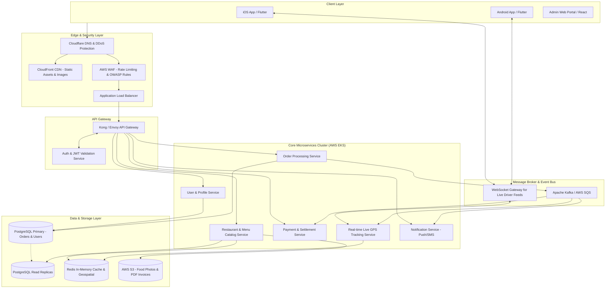
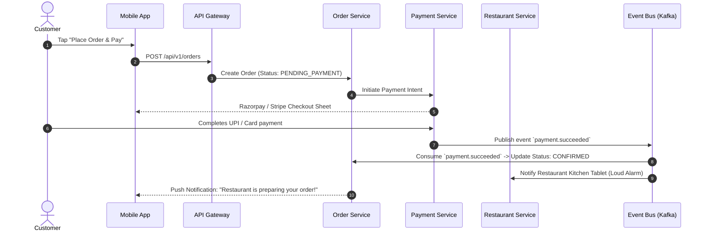

# 🏗️ High-Level Design (HLD) / System Architecture Document

> **Document Owner:** Principal Software Architect / Tech Lead  
> **Target Audience:** Engineering Team, DevOps, Security Team, Engineering Managers  
> **Version:** 1.0  
> **Status:** Approved  
> **Last Updated:** YYYY-MM-DD  

---

## 1. System Overview & Architecture Goals
*Yeh system kis scale ke liye design kiya gaya hai aur iske primary architectural goals kya hain?*

- **Target Throughput:** 5,000 requests per second (RPS) peak lunch rush.
- **Latency SLA:** 95th percentile (p95) API response time < 150ms.
- **Availability Target:** 99.95% uptime (< 22 minutes allowable downtime/year).
- **Architectural Style:** Event-driven modular microservices behind an API Gateway.

---

## 2. High-Level System Architecture Diagram

---

## 3. Technology Stack & Decision Matrix (Trade-offs)

| Component | Chosen Technology | Alternatives Considered | Decision Rationale (Kyun chuna?) |
|-----------|-------------------|--------------------------|----------------------------------|
| **Mobile Client** | Flutter (Dart) | React Native, Native Swift/Kotlin | Single codebase for iOS & Android with 60fps native performance and hot reload. |
| **Backend Services** | Node.js (NestJS / TypeScript) | Go, Python (FastAPI), Java (Spring) | Strong typing, high I/O throughput, rich NPM ecosystem, fast developer onboarding. |
| **Primary Database** | PostgreSQL 16 (AWS RDS) | MongoDB, MySQL | ACID compliance for financial orders, JSONB support for flexible menus, native GIS plugins. |
| **Caching & Geo-Index** | Redis Cluster | Memcached, DynamoDB | In-memory `GEOSEARCH` commands for ultra-fast driver proximity matching (< 5ms). |
| **Real-time Engine** | WebSockets (Socket.io / Go) | Polling, Server-Sent Events (SSE) | Bi-directional, sub-second GPS coordinate streaming between driver phone and customer. |
| **Event Streaming** | Apache Kafka / AWS MSK | RabbitMQ, SQS | High throughput, replayable event logs for order state machine transitions. |
| **Cloud Hosting** | AWS (EKS, ALB, RDS, S3) | Google Cloud, DigitalOcean | Enterprise maturity, Indian region availability (ap-south-1 Mumbai), auto-scaling. |

---

## 4. Key Architectural Patterns & Workflows

### 4.1 Order Placement & Saga Pattern (Distributed Transactions)
Microservices me distributed transaction ke liye **Choreography-based Saga Pattern** use hota hai taaki payment fail hone par order cleanly rollback ho sake:

---

## 5. Scalability, Caching & Performance Strategy

1. **Multi-Tier Caching:**
   - **Edge Caching:** CloudFront CDN static assets (restaurant logos, dish images) ko 30 din ke liye cache karega.
   - **Application In-Memory Caching:** Redis me restaurant menu aur metadata cache hoga (TTL: 15 minutes). Cache eviction webhook ke zariye trigger hoga jab restaurant item price badlega.
   - **Geospatial Proximity Queries:** Driver current locations Redis Geo set (`GEOADD drivers:active <lng> <lat> <driver_id>`) me store hongi, jo O(log N) speed me nearest rider dhundti hai.
2. **Database Read/Write Splitting:**
   - Sabhi Write operations (`INSERT`, `UPDATE`, `DELETE`) Primary DB master par jayenge.
   - Sabhi Search & Menu View operations read replicas par route honge via PgBouncer connection pooling.

---

## 6. Security & Compliance Architecture

- **Zero-Trust Network:** Internal microservices private subnets me rahengi, public access sirf ALB aur API Gateway ke paas hoga.
- **Authentication:** Stateless **OAuth2 + JWT (JSON Web Tokens)**. Access token TTL = 15 minutes, Refresh token TTL = 30 days (stored in HTTP-only secure cookie or native keychain).
- **Data Protection:**
  - AES-256 server-side encryption for all data at rest in PostgreSQL and AWS S3 buckets.
  - End-to-end TLS 1.3 encryption for all data in transit.
  - Sensitive customer PII (credit card number, CVV) kabhi hamare database me store nahi hoga (PCI-DSS compliance via Payment Gateway tokenization).

---

## 7. Disaster Recovery (DR) & High Availability

- **Availability:** Multi-Availability-Zone (Multi-AZ) deployment across 3 AWS data centers in Mumbai region.
- **Recovery Point Objective (RPO):** < 5 minutes (Continuous database write-ahead logs backup to S3).
- **Recovery Time Objective (RTO):** < 15 minutes (Automated Kubernetes pod failover and multi-AZ database switchover).
