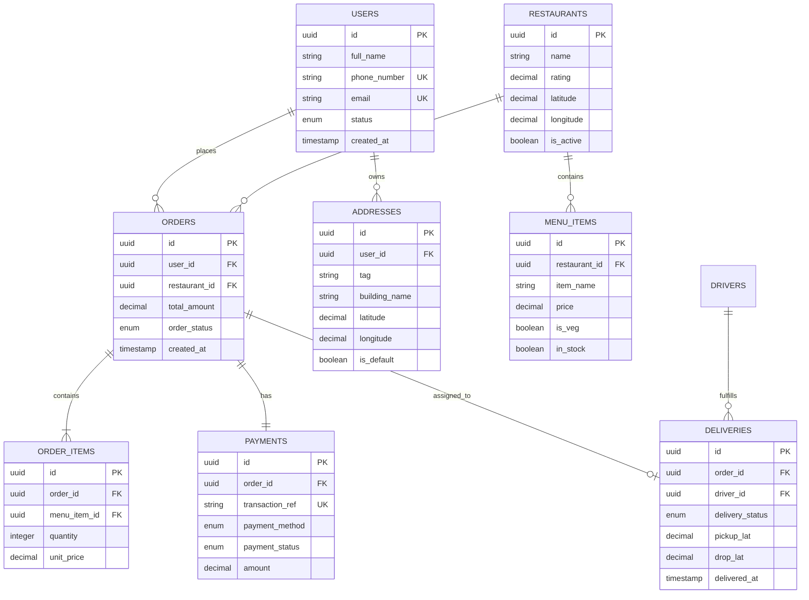
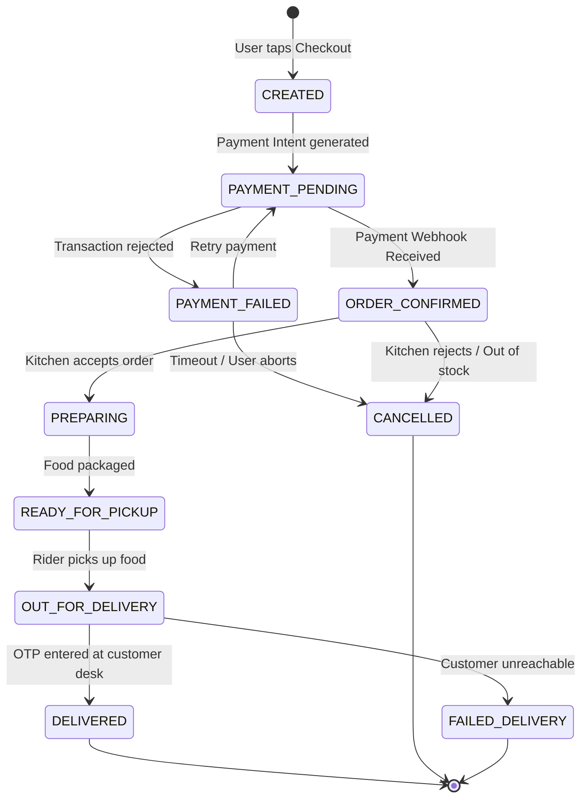

# ⚙️ Low-Level Design (LLD) Document

> **Document Owner:** Lead Backend Engineer / Senior Mobile Engineer  
> **Target Audience:** Software Developers, Code Reviewers, QA Automation  
> **Status:** Approved  
> **Version:** 1.0  

---

## 1. Database Schema & Entity-Relationship (ER) Diagram

PostgreSQL database tables, primary/foreign keys aur relationships ka design:



### 1.1 Key Database Table DDL (PostgreSQL Sample)

```sql
-- Orders Table Definition
CREATE TABLE orders (
    id UUID PRIMARY KEY DEFAULT gen_random_uuid(),
    user_id UUID NOT NULL REFERENCES users(id) ON DELETE RESTRICT,
    restaurant_id UUID NOT NULL REFERENCES restaurants(id) ON DELETE RESTRICT,
    total_amount NUMERIC(10, 2) NOT NULL CHECK (total_amount >= 0),
    delivery_fee NUMERIC(6, 2) DEFAULT 0.00,
    order_status VARCHAR(30) NOT NULL DEFAULT 'CREATED',
    delivery_address JSONB NOT NULL,
    cancellation_reason VARCHAR(255),
    created_at TIMESTAMP WITH TIME ZONE DEFAULT CURRENT_TIMESTAMP,
    updated_at TIMESTAMP WITH TIME ZONE DEFAULT CURRENT_TIMESTAMP
);

-- Indexing Strategy for Fast Lookups
CREATE INDEX idx_orders_user_id ON orders(user_id);
CREATE INDEX idx_orders_status ON orders(order_status);
CREATE INDEX idx_orders_created_at ON orders(created_at DESC);
```

---

## 2. Order Lifecycle Finite State Machine (FSM)

Order kisi bhi time kis state me ho sakta hai aur kaunse valid transitions allowed hain:



---

## 3. Design Patterns Applied

### 3.1 Strategy Pattern for Payment Gateways
Alag-alag payment providers (Razorpay, Stripe, Cashfree) ko dynamically switch karne ke liye **Strategy Pattern** use kiya jata hai:

```typescript
// Payment Strategy Interface
export interface IPaymentStrategy {
  createPaymentIntent(amount: number, orderId: string): Promise<PaymentResponse>;
  verifyPaymentSignature(payload: WebhookPayload): Promise<boolean>;
  refund(transactionId: string, amount: number): Promise<RefundResponse>;
}

// Razorpay Implementation
export class RazorpayStrategy implements IPaymentStrategy {
  async createPaymentIntent(amount: number, orderId: string): Promise<PaymentResponse> {
    // Razorpay SDK Call
    return { provider: 'RAZORPAY', orderId, status: 'INITIATED' };
  }
  // ... verify and refund
}

// Strategy Context Resolver
export class PaymentContext {
  private strategy: IPaymentStrategy;

  constructor(strategy: IPaymentStrategy) {
    this.strategy = strategy;
  }

  public setStrategy(strategy: IPaymentStrategy) {
    this.strategy = strategy;
  }

  public async processPayment(amount: number, orderId: string) {
    return this.strategy.createPaymentIntent(amount, orderId);
  }
}
```

---

## 4. Core Algorithms & Logic: Rider Assignment

Nearest delivery partner assign karne ka logic (Geospatial Radius Matching):

```python
# Nearest Available Driver Search Algorithm
def find_optimal_driver(restaurant_lat, restaurant_lng, max_radius_km=2.0):
    """
    1. Query Redis GeoSet for drivers with status 'AVAILABLE' within radius.
    2. Rank drivers based on:
       Score = (0.6 * Distance_km) + (0.4 * Wait_time_minutes)
    3. Send notification ping to the top-ranked driver.
    4. Wait 15 seconds for acceptance. If timeout, cascade to next driver.
    """
    nearby_drivers = redis_client.geosearch(
        name="drivers:online",
        longitude=restaurant_lng,
        latitude=restaurant_lat,
        radius=max_radius_km,
        unit="km",
        withdist=True,
        count=5
    )

    if not nearby_drivers:
        # Expand search radius or notify dispatch team
        return None

    return nearby_drivers[0]  # Best match driver
```

---

## 5. Standard Error Handling & Domain Error Codes

Frontend aur backend ke uniform error mapping ke liye standard format:

```json
{
  "success": false,
  "error": {
    "code": "ERR_PAYMENT_FAILED",
    "message": "Your bank card was declined due to insufficient balance.",
    "field": "payment_method",
    "timestamp": "2026-10-20T10:15:30Z",
    "tracking_id": "req-9884a-1120-f56"
  }
}
```
